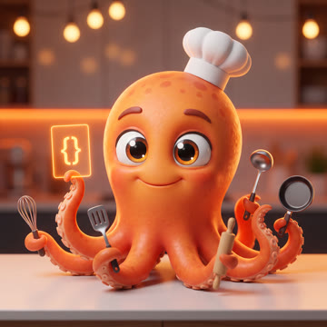

<p align="center"></p>

# skills.kitchen

Open-source Claude skills for creators, one per clip on [Instagram](https://www.instagram.com/skills.kitchen/) and TikTok. Each one works as a Claude skill (clone it into `~/.claude/skills/`) or as a plain Python CLI.

| Skill | What it does |
|---|---|
| [Faceless Shorts Studio](https://github.com/niyonx/faceless-shorts-studio) | One idea in, a voiced and captioned 9:16 short out (clay scale comparisons, tiny worlds, clay planets) |
| [Flop Doctor](https://github.com/niyonx/flop-doctor) | Compares a flopped reel with your own best posts, rewrites the hook and retests it as an Instagram Trial Reel |
| [UGC Ad Studio](https://github.com/niyonx/ugc-ad-studio) | Ad angles from real 1-star reviews, scripts checked by a linter, creator briefs, Trial Reel testing |

Install one:

```
git clone https://github.com/niyonx/faceless-shorts-studio ~/.claude/skills/faceless-shorts-studio
```

Posting steps use [PostOnce](https://postonce.to?utm_source=github&utm_campaign=skills-kitchen), which publishes through each platform's official API. New skills are added here as they ship.
